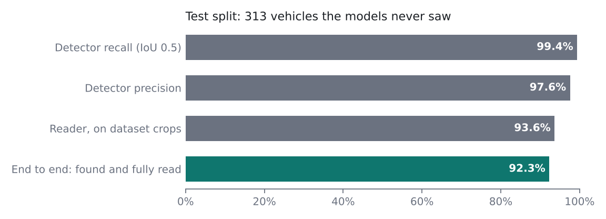
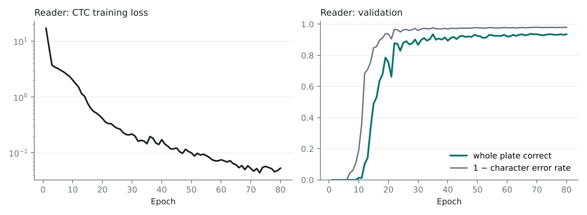
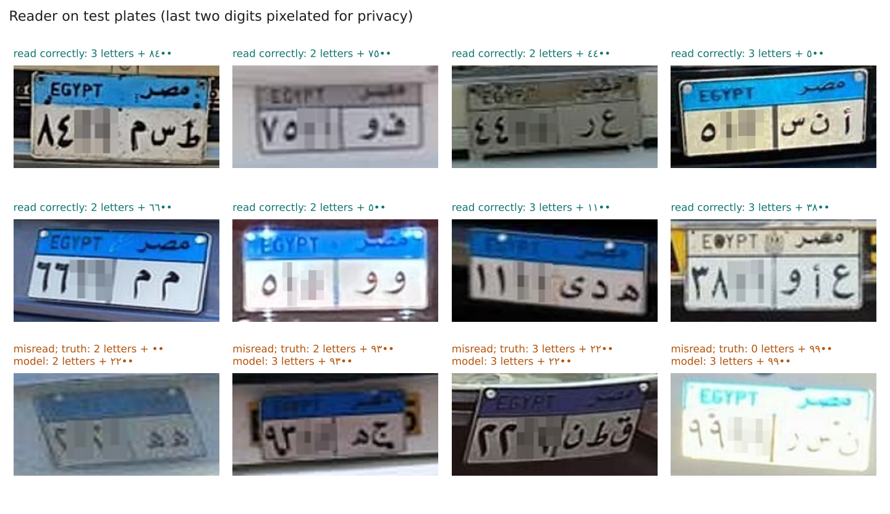

# Lawha لوحة

Arabic licence plate recognition in two stages, trained on Egyptian plates and runnable in the browser.

**[Live demo](https://readaloush.github.io/lawha/)** · choose a photo of a car; the plate is found and read on your device, the photo is never uploaded.

1. **Detector** — a pretrained YOLO11 nano model fine-tuned to find plates in vehicle photos.
2. **Reader** — a 1.3M-parameter CRNN written in PyTorch and trained from scratch with CTC loss. It takes the whole plate crop and outputs the Arabic letters and digits, with no character segmentation step.



## Results

All numbers are on 313 held-out vehicle photos (323 plates, 299 of them with character labels) that neither model saw in training.

| Stage | Metric | Result |
|---|---|---|
| Detector | Recall at IoU 0.5 | **99.4%** (321 of 323 plates) |
| Detector | Precision at confidence 0.25 | 97.6% (8 false boxes) |
| Detector | mAP50 / mAP50-95 | 0.993 / 0.898 |
| Reader, on the dataset's plate crops | Whole plate correct | **93.6%** (280 of 299) |
| Reader, on the dataset's plate crops | Character error rate | 1.9% |
| **End to end** | Plate found and every character correct | **92.3%** (276 of 299) |
| End to end, in the browser (ONNX + JavaScript) | Same measure, 287 plates | 91.6% |

Of the 23 end-to-end failures, 2 are plates the detector missed and 21 are misreads.

Trained on a Kaggle T4 GPU; the whole notebook, both models included, runs in about 22 minutes: [`notebooks/lawha_kaggle.ipynb`](notebooks/lawha_kaggle.ipynb). I re-ran the evaluation on CPU with the Kaggle weights and got identical numbers.





Plates in this figure are real, so the last two digits are pixelated in the image and hidden in the text.

## What the errors are

I looked at all 19 plates the reader got "wrong" on the test crops.

- In **12 of the 19**, by my reading of the image, the label is incomplete or wrong and the model's output matches the plate: for example a plate with four digits and three letters whose label lists only the digits. I did not correct the labels or rescore, so 93.6% stays the reported number; the true accuracy is probably a few points higher.
- The other 7 are real mistakes: a dropped, added or substituted character. Two of them are a digit lost inside a run of identical digits (١١١١, ٦٦٦٦), a known weakness of CTC decoding.

Accuracy by plate length shows the same picture: standard 6 and 7 character plates read at 94.4% and 97.8%; the few 1, 3 and 5 character plates, where labels are most often incomplete, drag the average down.

## Limitations

- **The data is not a random sample of traffic.** EALPR was collected largely from listings of special plates, so repeated digits are over-represented. Everyday plates may read worse.
- **Egypt only.** Other countries use different layouts and character sets; nothing here was tested on them.
- **Computer-drawn plates fail.** I drew synthetic plates with ordinary Arabic fonts: the detector found 30 of 30, the reader got 1 of 30 right. The reader has learned the Egyptian plate typeface, not Arabic digits in general.
- **Label noise**, as described above, affects both training and the reported accuracy.
- One training run per model, one seed.

## How it works

```
photo ──> YOLO11n (640 px) ──> plate box ──> crop with 10% margin ──> 48×144 grayscale
                                                                          │
                              letters + digits <── CTC greedy decode <── CRNN
```

**Split.** EALPR links photo, plate crop and character labels by vehicle id. The 70/15/15 split is made by vehicle id and shared by both models, so a plate crop is never in training while its photo is in the test set. See [`lawha/data.py`](lawha/data.py).

**Reader.** Five conv blocks reduce the crop to a 36-step sequence, two bidirectional GRU layers model it, and a linear layer scores 27 characters plus the CTC blank. Sequence labels come from the dataset's character boxes sorted left to right. Augmentation: small rotation, shear and scale, blur, down-sampling, exposure and noise; no flips. See [`lawha/reader.py`](lawha/reader.py).

**Detector.** Ultralytics YOLO11n, 60 epochs at 640 px, horizontal flip turned off. See [`lawha/detector.py`](lawha/detector.py).

**Evaluation.** [`lawha/pipeline.py`](lawha/pipeline.py) scores the reader alone, the detector alone and the full chain, and writes every failure to `results/pipeline_errors.json` (not published here, because it lists real plate numbers).

**Browser.** Both models are exported to ONNX (reader output matches PyTorch to 1e-5) and run with onnxruntime-web. Letterboxing, box decoding, non-maximum suppression, cropping and CTC decoding are reimplemented in JavaScript in [`docs/index.html`](docs/index.html), and [`tests/browser_check.py`](tests/browser_check.py) scores that pipeline on the test photos in headless Chrome.

## Reproduce

```bash
pip install -r requirements.txt
git clone --depth 1 https://github.com/ahmedramadan96/EALPR.git data/EALPR

python -m lawha.detector prepare          # build the YOLO dataset with the shared split
python -m lawha.train_reader --epochs 80  # about 25 min on 2 CPU cores, 2 min on a T4
python -m lawha.detector train --epochs 60
python -m lawha.pipeline                  # metrics on the test split
python -m lawha.report                    # figures
python -m lawha.export                    # ONNX
```

The trained weights are in `docs/models/` as ONNX files split into parts (a limit of how this repository was uploaded). To reassemble: `cat docs/models/detector.onnx.part* > detector.onnx`, and the same for `reader`.

## Data, privacy and licences

- **EALPR**: Ahmed Ramadan Youssef, Fawzya Ramadan Sayed and Abdelmgeid Ameen Ali, *A New Benchmark Dataset for Egyptian License Plate Detection and Recognition*, ACIRS 2022, [github.com/ahmedramadan96/EALPR](https://github.com/ahmedramadan96/EALPR). The dataset is **not redistributed** here; scripts download it from the authors' repository. It was published without a licence, and this project uses it for non-commercial research only.
- Plates identify real vehicles. No full plate from the dataset appears in this repository's figures, and the demo processes photos locally.
- The detector uses [Ultralytics](https://github.com/ultralytics/ultralytics), which is AGPL-3.0; the fine-tuned detector weights inherit that licence. The rest of the code in this repository is MIT.
